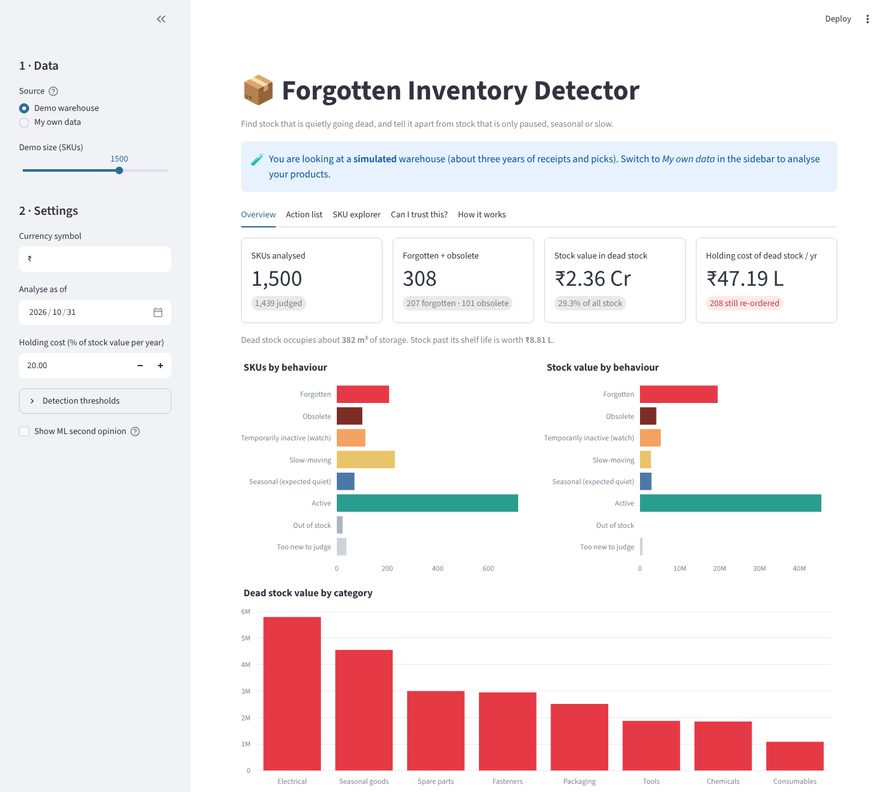
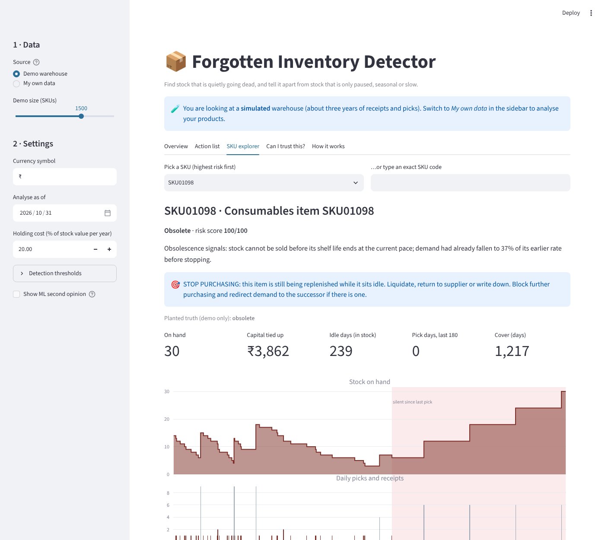

#  Forgotten Inventory Detector

**Find stock that is quietly going dead, and tell it apart from stock that is only paused, seasonal or slow.**

A warehouse manager usually knows *how much* inventory there is, but not which of it has silently stopped moving. The usual fix is a rule such as "no pick in 90 days". That rule flags seasonal items that are merely out of season and slow movers that are behaving normally, and it flags genuinely dead stock a month late.

This project replaces it with a per-SKU statistical test of *"how unusual is this silence for this product?"*, plus seasonality and obsolescence checks, and wraps it in a Streamlit app that works on your own movement data.



## What it does

For every SKU in stock it assigns one of six behaviours, a 0–100 risk score, the money and space tied up, and a recommended action.

| Class | Meaning |
|---|---|
| **Forgotten** | A long *and* statistically unusual silence, or stock that arrived long ago and was never picked |
| **Obsolete** | Dead and has no future: expiring stock, a successor SKU has taken over, or demand faded out |
| **Temporarily inactive (watch)** | Unusually quiet, not yet long enough to call it dead |
| **Slow-moving** | Few picks, but the current gap is normal for that rhythm |
| **Seasonal** | Strong yearly pattern and equally quiet this time last year |
| **Active** | Picked regularly |

It also flags **items that are still being re-ordered while idle** (stop purchasing!), and reports the capital, annual holding cost and storage space tied up in dead stock.

## Try it

```bash
git clone <your-repo-url> && cd forgotten-inventory-detector
pip install -r requirements.txt
streamlit run app/streamlit_app.py
```

The app opens on a simulated demo warehouse. Choose **My own data** in the sidebar to analyse your products.

### Using your own data

You need one table of stock movements (CSV or Excel), one row per receipt or pick, with a **SKU**, a **date** and a **quantity**. The app suggests a column mapping and you confirm it. Movements can be described three ways:

1. a column saying receipt / issue (GRN, dispatch, in, out, …),
2. a signed quantity (positive = in, negative = out),
3. sales only, in which case the SKU master must include the current on-hand quantity.

An optional SKU master adds unit cost, shelf life, volume, location, category, on-hand quantity and successor SKU, which unlock money, expiry, space and obsolescence figures. Templates are in [`templates/`](templates/); a ready-to-try sample is in [`data/sample/`](data/sample/).

The app gives you an overview, a filterable **action list** (CSV and Excel export), a per-SKU **explorer** with a stock/pick timeline and the reasoning behind each verdict, and a **"Can I trust this?"** tab that backtests the detector on *your own history* with no labels needed.



## How it works (short version)

1. **Idle time is counted only on in-stock days**, so a SKU that was out of stock is not "neglected".
2. **Each SKU is judged against its own rhythm.** From its past gaps between picks, two models (exponential and log-normal) estimate how likely a quiet spell this long is; both must agree it is unusual.
3. **Seasonality:** a strong yearly profile that was equally quiet this time last year makes the silence *expected*.
4. **Obsolescence:** stock that can't be sold before it expires, a successor SKU that has taken over, or demand that was already fading.

Details, formulas and thresholds: [`docs/METHOD.md`](docs/METHOD.md).

## Results

> **Important: these are results on a *simulated* warehouse.** No public dataset records which stock was forgotten, so the evaluation plants known behaviours into a simulated 10,000-SKU warehouse and checks whether the engine recovers them. That shows the method separates the behaviours it was designed to separate. It does **not** show how it will fare on a real warehouse. See *Results on real demand* below, which are less flattering.

10,000 SKUs, 3 years of receipts and picks from a reorder-point replenishment simulation, 120 further days held out. Full report with all tables and figures: [`reports/evaluation.md`](reports/evaluation.md). Reproduce with `python scripts/run_evaluation.py`.

| Finding dead stock (forgotten + obsolete) | Precision | Recall | F1 |
|---|---|---|---|
| Naive: no pick in 90 days | 0.76 | 0.98 | 0.85 |
| Naive: no pick in 60 days | 0.61 | 1.00 | 0.76 |
| **Engine** | **0.82** | **1.00** | **0.90** |

- **Seasonal SKUs wrongly called dead:** 7 for the engine vs 113 for the naive 90-day rule (of 886).
- **At the same 60-day threshold the naive rule has the same recall but much lower precision** (0.61 vs 0.82), so the gain comes from judging each SKU against its own rhythm and seasonality.
- **Label-free backtest** (classify 90 days ago, see what happened): 94% of SKUs the engine flagged dead stayed untouched, versus 77% for the naive rule. The naive rule flagged 489 SKUs the engine did not, and 301 of them were picked again.
- **Six-class accuracy:** 86.9%.
- **Speed of detection:** median 64 days after a planted stop, versus 93 for the naive 90-day rule. This is no earlier than a naive rule set to 60 days; the lead comes from the lower threshold, which the statistical test makes affordable.

### What the engine gets wrong

- A fast mover paused for 60+ days looks exactly like a dead one at that moment. About a third of planted pauses were flagged *forgotten*. The app surfaces them for investigation rather than claiming certainty.
- With `p ≤ 0.05`, roughly one in twenty healthy slow movers is flagged by chance.
- Seasonal recall is 58%: the engine reacts after a trough has started.
- Defaults were set from first principles and a first look at one simulation, not tuned for the scores. The threshold sweep in the report shows a 90-day idle threshold scoring best on this simulation, but only because simulated pauses never exceed 80 days; don't treat that as a recommendation.

### ML second opinion

A gradient-boosting classifier on the engine's features reaches 98% accuracy on a fresh simulated warehouse. That mostly shows it learns the *simulator's* labels, not that it would beat the engine on real data. It is therefore optional (a sidebar checkbox) and labelled as a secondary view.

## Results on real demand (M5)

Real Walmart sales (M5, store CA_1, 3,049 SKUs, as-of 2016-01-23) with a simulated supply side. Forgotten, obsolete and paused behaviour was planted on 593 SKUs; the other 2,456 keep their untouched real demand and have no labels. Full report: [`reports/real/evaluation.md`](reports/real/evaluation.md). Reproduce:

```bash
# kaggle competitions download -c m5-forecasting-accuracy   (accept the rules on Kaggle first)
python scripts/prepare_real_demand.py --m5-dir path/to/m5 --store CA_1 --since 2013-01-01
python scripts/run_evaluation.py --real-sales data/real/sales.csv --out reports/real
```

**The synthetic advantage mostly does not carry over.** On untouched real SKUs the statistical test barely beats a plain idle-days rule at the same threshold:

| Idle threshold | Engine flags / 100 SKUs | Naive flags / 100 SKUs | Engine planted recall | Naive planted recall |
|---|---|---|---|---|
| 60 days | 6.7 | 7.2 | 0.98 | 1.00 |
| 90 days | 4.0 | 4.3 | 0.91 | 0.93 |
| 120 days | 3.0 | 3.2 | 0.73 | 0.75 |

- About 99% of the dead flags on untouched SKUs were picked again within the next 120 days, for the engine and the naive rule alike. On this data they are almost all false alarms, whichever method is used.
- Label-free backtest (planted SKUs excluded, classified 90 days earlier): 37.7% of the engine's 154 forgotten/obsolete flags stayed dormant, against 45.6% of the naive 90-day rule's 114 flags. That is roughly 9x the 4.3% dormancy of all SKUs, so the flag is a useful triage signal, but it is not a verdict. The naive rule's stricter threshold gave it the higher hit rate.
- Planted labels: engine precision 0.84 / recall 0.98 against naive-60 0.84 / 1.00 and naive-90 0.96 / 0.93. The 90-day rule scores best partly because planted pauses last at most 80 days.
- Six-class accuracy on the planted SKUs is 53.8% (vs 86.9% on the simulation). Obsolete recall is 4%: faded SKUs are mostly called forgotten, which leads to the same action.
- Only 2 SKUs were called seasonal, so seasonality was barely exercised here.

**What this means.** The per-SKU test is not what makes the tool useful on M5. Most of the value comes from the surrounding pieces: counting idle time only on in-stock days, putting money and space on each SKU, the replenishment-conflict flag, and the backtest that lets you pick a threshold on your own history. M5 has no real stock records (stock is simulated), so the in-stock logic could not show an advantage here. Treat the simulated results above as a design check, and use the backtest tab on your own data to choose your idle threshold.

## Project layout

```
app/streamlit_app.py      the Streamlit app
fid/                      the package
  schema.py               column mapping, cleaning, stock reconciliation, data-quality checks
  features.py             vectorised per-SKU features (idle time, gaps, seasonality, stock age, expiry)
  survival.py             probability of a quiet spell this long under the SKU's own history
  classify.py             decision rules, risk score, money, actions
  pipeline.py             analyze() entry point
  simulate.py             warehouse simulator with planted ground truth (synthetic or on real sales)
  realdata.py             loaders for M5 and Online Retail II
  evaluate.py             planted-truth scoring, baselines, lead time, label-free backtest
  ml.py                   optional ML second opinion
  export.py               file reading, tidy tables, Excel export
scripts/                  run_evaluation.py, prepare_real_demand.py
reports/                  generated evaluation report, metrics and figures
templates/  data/sample/  input templates and a small sample warehouse
tests/                    pytest suite (engine, simulator, cleaning, loaders, export, app)
```

Use it as a library:

```python
from fid import analyze, Config
a = analyze(movements, sku_master, Config(dead_min_idle_days=45))
a.result[a.result["status"] == "forgotten"].sort_values("value_at_risk", ascending=False)
```

## Deploying the app

On [Streamlit Community Cloud](https://streamlit.io/cloud): push this repo to GitHub, create a new app, set the main file to `app/streamlit_app.py`. `requirements.txt` is all it needs. Uploaded data is processed in memory and not stored by the app. The saved ML model is tied to the scikit-learn version it was trained with; if the versions differ the app quietly hides the ML option (retrain with `python scripts/run_evaluation.py`).

## Tests

```bash
pytest          # 25 tests, including driving the Streamlit app headlessly
```

## Limitations

- Synthetic ground truth is the generator's own; real warehouses have promotions, kitting, customer-specific stock, data-entry errors and multi-location transfers that are not simulated.
- Demand is counted in pick *days*, not order lines; one huge order looks like one pick.
- Seasonality needs about two years of history; the app warns when it can't be assessed.
- Money figures use the unit costs you supply (and a default 20% annual holding cost, adjustable).

## License

MIT, see [LICENSE](LICENSE).
