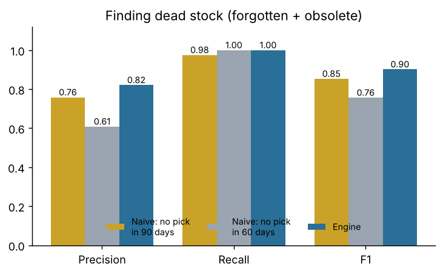
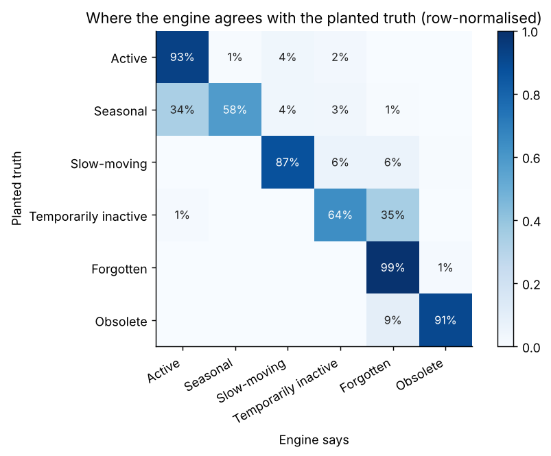
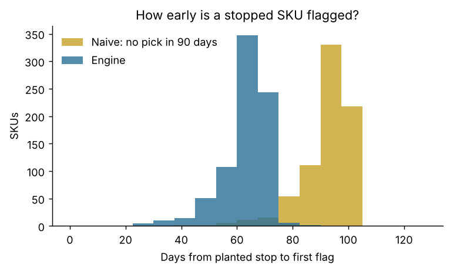
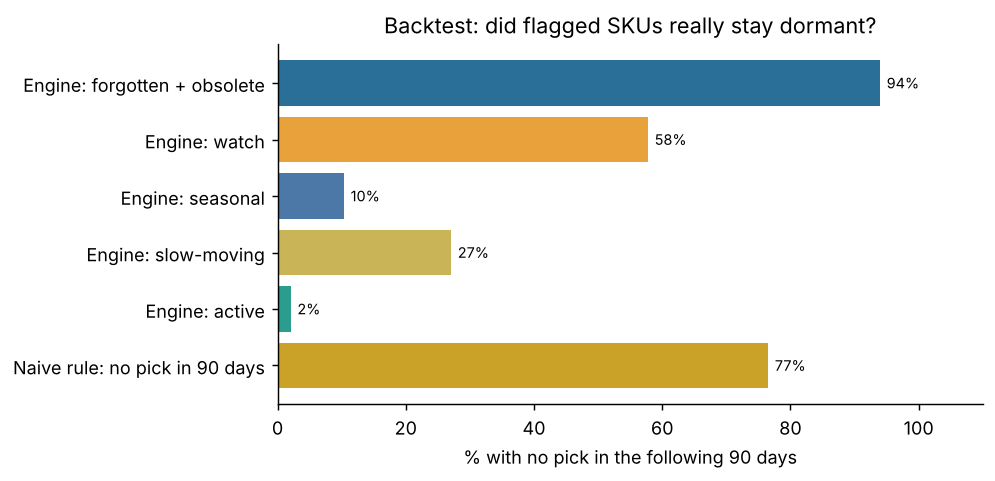
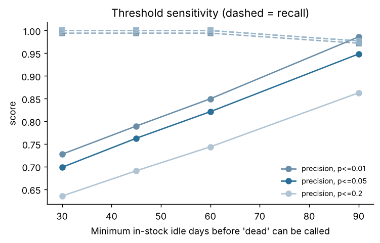
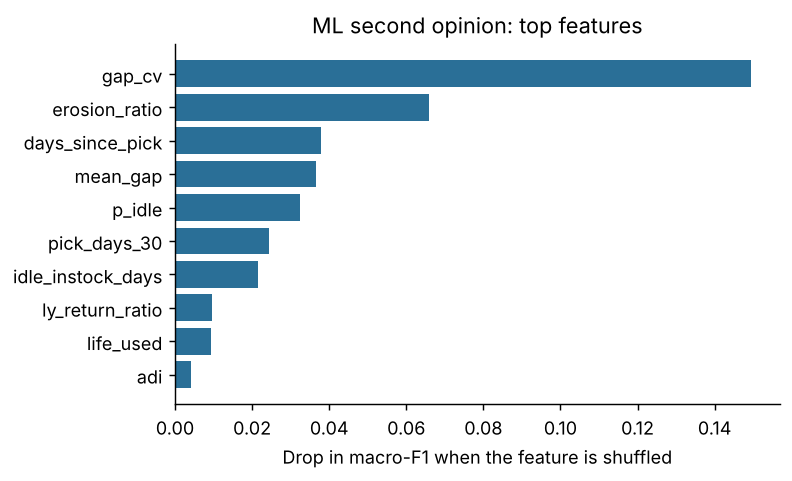

# Evaluation report

*Generated by `scripts/run_evaluation.py` in 58s. Every number below is computed, not typed.*

## Setup

- Data: a **simulated** warehouse (synthetic demand archetypes, reorder-point replenishment); 10,000 SKUs, as-of date 2026-10-31, seed 21.
- Ledger: 3,316,326 movements up to the as-of date, plus 313,902 held-out movements after it.
- Planted truth on the as-of date: active 4,789, slow_moving 1,473, forgotten 1,028, seasonal 886, temporarily_inactive 811, obsolete 722, insufficient_history 291.
- Scored: 9,593 in-stock SKUs (128 out-of-stock excluded; too-new SKUs excluded from the class scores).
- Default thresholds (`fid/config.py`) were set from first principles and a first look at one simulation; they are **not** fitted to optimise the scores below. Change them in the app's sidebar.

> **Read this first.** On simulated data the planted truth is the generator's own labels, so these scores measure whether the engine recovers the behaviours it was designed to separate, not how it will fare on a real warehouse. Use the label-free backtest (section 4) on real data.

## 1. Finding dead stock (forgotten + obsolete)

| Method | precision | recall | f1 | tp | fp | fn |
|---|---|---|---|---|---|---|
| Naive: no pick in 90 days | 0.758 | 0.975 | 0.853 | 1,707 | 544 | 43 |
| Naive: no pick in 60 days | 0.608 | 1.000 | 0.757 | 1,750 | 1,126 | 0 |
| Engine | 0.821 | 1.000 | 0.902 | 1,750 | 381 | 0 |

- Of the SKUs the engine flagged dead, **16.8%** were picked again in the held-out future; for the naive 90-day rule it was **18.3%** (2,251 flagged).
- Seasonal SKUs wrongly called dead: engine **7**, naive 90-day rule **113** (of 886 seasonal SKUs).
- At the *same* 60-day idle threshold the naive rule has precision 0.61 against the engine's 0.82 (recall 1.00 vs 1.00), so here the gain comes from testing each SKU against its own rhythm and its seasonality, not from flagging earlier.

## 2. Six-class behaviour

Overall accuracy on the six classes: **86.9%**.

| class | support | precision | recall | f1 |
|---|---|---|---|---|
| active | 4,717 | 0.933 | 0.931 | 0.932 |
| seasonal | 886 | 0.952 | 0.580 | 0.721 |
| slow_moving | 1,429 | 0.852 | 0.871 | 0.861 |
| temporarily_inactive | 811 | 0.686 | 0.639 | 0.662 |
| forgotten | 1,028 | 0.697 | 0.986 | 0.817 |
| obsolete | 722 | 0.966 | 0.906 | 0.935 |

Honest reading of the confusions:

- *Temporarily inactive → forgotten.* A fast mover silent for 60+ in-stock days looks exactly like a dead one at that moment; only the future tells them apart. The engine deliberately surfaces these for investigation. This is the main source of false alarms.
- *Slow-moving → forgotten / watch.* With p<=0.05 about one in twenty healthy slow movers is flagged by chance. The threshold sweep (section 5) shows the trade-off.
- *Obsolete → forgotten.* Both are dead, so the action is the same; the fade is sometimes too noisy to see.
- *Seasonal → active.* The engine reacts after a trough has started, so some SKUs are still called active early in the off-season.

## 3. How early is a stopped SKU caught?

789 SKUs whose demand stopped abruptly; checked every 15 days (so delays have ±15-day resolution).

| Method | SKUs detected | share of stopped SKUs | median days after stop | 90th pct days |
|---|---|---|---|---|
| Naive: no pick in 90 days | 750 | 0.951 | 93.000 | 101.000 |
| Naive: no pick in 60 days | 789 | 1.000 | 64.000 | 71.000 |
| Engine | 789 | 1.000 | 64.000 | 71.000 |

Median delay: engine 64 days, naive 90-day rule 93 days, naive 60-day rule 64 days. Whatever lead the engine has over the 90-day rule comes from its lower idle threshold (60 in-stock days); it is not earlier than a naive rule set to that same threshold.

## 4. Label-free backtest (works on any real data)

Classify as of 2026-08-02, then check what happened in the next 90 days. No labels needed.

| Group at the earlier date | n_skus | stayed_dormant_pct | picked_again_pct | capital_tied |
|---|---|---|---|---|
| Engine: forgotten + obsolete | 1,452 | 94.0 | 6.0 | 89,899,532 |
| Engine: forgotten | 850 | 90.9 | 9.1 | 59,211,329 |
| Engine: obsolete | 602 | 98.3 | 1.7 | 30,688,203 |
| Engine: watch | 403 | 57.8 | 42.2 | 16,572,704 |
| Engine: seasonal | 577 | 10.4 | 89.6 | 32,233,047 |
| Engine: slow-moving | 1,505 | 27.1 | 72.9 | 20,630,666 |
| Engine: active | 5,593 | 2.1 | 97.9 | 402,719,102 |
| Naive rule: no pick in 90 days | 1,613 | 76.6 | 23.4 | 83,530,180 |
| All judged SKUs | 9,530 | 22.9 | 77.1 | 562,055,051 |

- The naive rule flagged 489 SKUs the engine did not; **301** of them were picked again, i.e. false alarms the engine avoided.

## 5. Threshold sensitivity

| setting | precision | recall | f1 |
|---|---|---|---|
| p<=0.01, idle>=30d | 0.727 | 0.994 | 0.840 |
| p<=0.01, idle>=45d | 0.789 | 0.994 | 0.880 |
| p<=0.01, idle>=60d | 0.850 | 0.994 | 0.916 |
| p<=0.01, idle>=90d | 0.986 | 0.972 | 0.979 |
| p<=0.02, idle>=30d | 0.720 | 0.998 | 0.836 |
| p<=0.02, idle>=45d | 0.782 | 0.998 | 0.877 |
| p<=0.02, idle>=60d | 0.842 | 0.998 | 0.913 |
| p<=0.02, idle>=90d | 0.976 | 0.975 | 0.975 |
| p<=0.05, idle>=30d | 0.699 | 1.000 | 0.823 |
| p<=0.05, idle>=45d | 0.763 | 1.000 | 0.865 |
| p<=0.05, idle>=60d | 0.821 | 1.000 | 0.902 |
| p<=0.05, idle>=90d | 0.948 | 0.977 | 0.963 |
| p<=0.1, idle>=30d | 0.672 | 1.000 | 0.804 |
| p<=0.1, idle>=45d | 0.734 | 1.000 | 0.846 |
| p<=0.1, idle>=60d | 0.789 | 1.000 | 0.882 |
| p<=0.1, idle>=90d | 0.911 | 0.977 | 0.943 |
| p<=0.2, idle>=30d | 0.635 | 1.000 | 0.777 |
| p<=0.2, idle>=45d | 0.691 | 1.000 | 0.817 |
| p<=0.2, idle>=60d | 0.744 | 1.000 | 0.853 |
| p<=0.2, idle>=90d | 0.863 | 0.977 | 0.916 |

**Do not read the 90-day row as an optimum.** Planted pauses in this simulation last up to 80 idle days, so any threshold above 80 trivially removes them. In a real warehouse the right value depends on how long your products legitimately sit quiet; use the backtest on your own data to choose.

## 6. ML second opinion (trained on simulated warehouses only)

Fresh simulated warehouse never seen in training (5,775 SKUs).

| Metric | Engine | Gradient boosting |
|---|---|---|
| Accuracy (6 classes) | 0.864 | 0.978 |
| Macro-F1 | 0.811 | 0.965 |
| Dead-vs-alive F1 | 0.895 | 0.989 |

The model learns the *simulator's* labels from the engine's features, so a score above the engine here shows it fits that generator, not that it will beat the engine on your data. It ships as an optional, clearly labelled second view; disagreement between the two is a useful prompt to look at a SKU by hand.

## Limitations

- Synthetic truth is the generator's own; real warehouses have behaviours not simulated here (promotions, kitting, customer-specific stock, data-entry errors, multi-location transfers).
- Demand is counted in pick *days*, not order lines; a single huge order looks like one pick.
- Seasonality needs about two years of history; with less, strongly seasonal SKUs can be mistaken for neglected ones (the app warns).
- Money figures use the unit cost you supply; without it the app reports units (cost 1.0).
