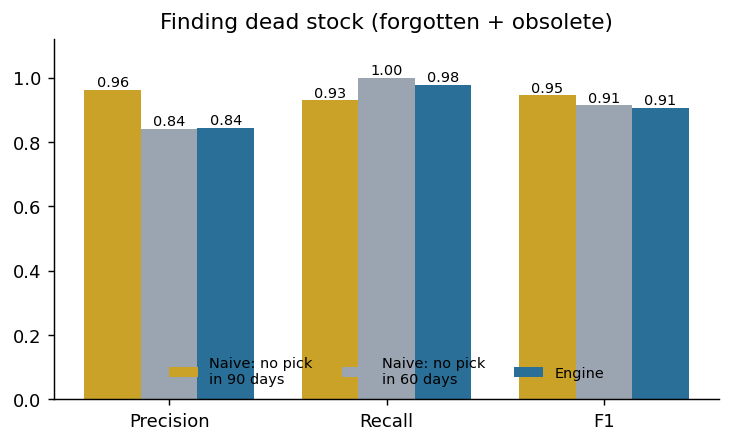
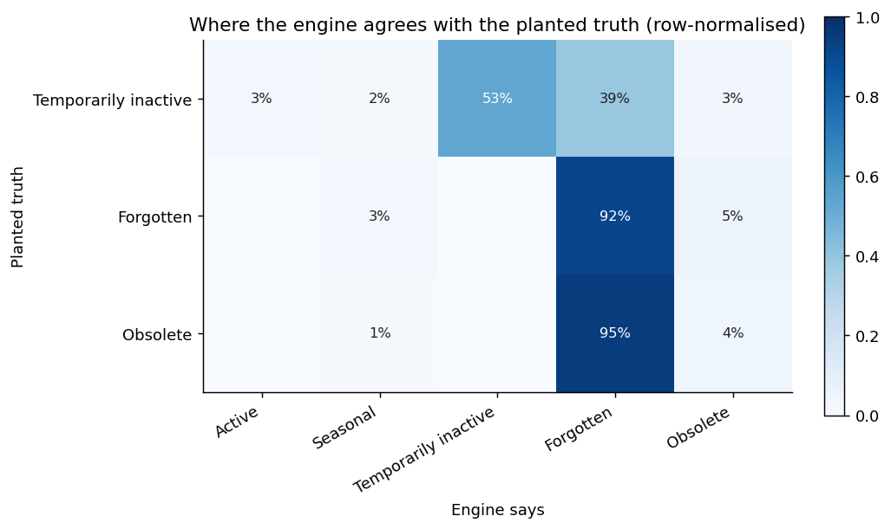
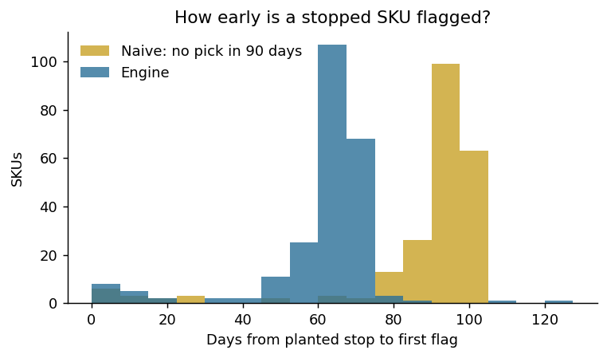
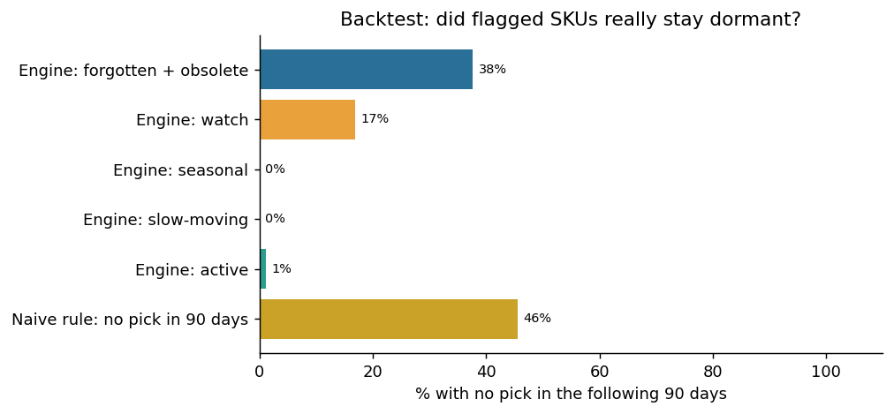
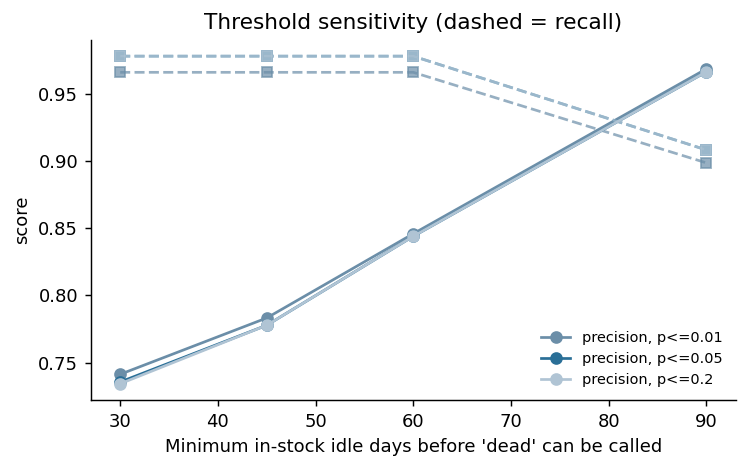

# Evaluation report

*Generated by `scripts/run_evaluation.py` in 19s. Every number below is computed, not typed.*

## Setup

- Data: **real sales history** with planted forgotten / obsolete / paused behaviour; 3,049 SKUs, as-of date 2016-01-23, seed 21.
- Ledger: 1,394,119 movements up to the as-of date, plus 150,141 held-out movements after it.
- Planted truth on the as-of date: unlabelled 2,456, forgotten 237, temporarily_inactive 178, obsolete 178.
- Scored: 3,023 in-stock SKUs (26 out-of-stock excluded; too-new SKUs excluded from the class scores).
- Default thresholds (`fid/config.py`) were set from first principles and a first look at one simulation; they are **not** fitted to optimise the scores below. Change them in the app's sidebar.

> **Read this first.** Demand here is real, but only the *planted* SKUs have labels. Precision/recall below are computed over those planted SKUs alone, so false alarms on the unlabelled real SKUs (where a naive rule tends to misfire on slow and seasonal items) are not counted in them. Section 1 therefore adds a label-free comparison on the unlabelled SKUs, and section 4 (the backtest) is the fairer test.

## 1. Finding dead stock (forgotten + obsolete)

| Method | precision | recall | f1 | tp | fp | fn |
|---|---|---|---|---|---|---|
| Naive: no pick in 90 days | 0.963 | 0.930 | 0.946 | 386 | 15 | 29 |
| Naive: no pick in 60 days | 0.842 | 1.000 | 0.914 | 415 | 78 | 0 |
| Engine | 0.844 | 0.978 | 0.906 | 406 | 75 | 9 |

- Of the SKUs the engine flagged dead, **36.8%** were picked again in the held-out future; for the naive 90-day rule it was **23.2%** (505 flagged).
- At the same 60-day idle threshold the engine's precision (0.84) is not clearly better than the naive rule's (0.84) on the labelled SKUs.
- Against the naive **90-day** rule the engine's precision on the labelled SKUs is lower (0.84 vs 0.96) because it flags earlier; see the label-free comparison below.
- **Unlabelled real SKUs (label-free):** the engine flagged 163 as dead, of which 99.4% were picked again in the held-out window; the naive 90-day rule flagged 104 (98.1% picked again) and the naive 60-day rule 175 (98.9% picked again). These SKUs keep their real demand, so a high share picked again means most of those flags are false alarms; see section 6 for the trade-off.

## 2. Six-class behaviour

Overall accuracy on the six classes: **53.8%** (planted SKUs only; unlabelled real SKUs have no true class).

| class | support | precision | recall | f1 |
|---|---|---|---|---|
| temporarily_inactive | 178 | 0.351 | 0.534 | 0.423 |
| forgotten | 237 | 0.361 | 0.916 | 0.518 |
| obsolete | 178 | 0.163 | 0.039 | 0.063 |

Honest reading of the confusions:

- *Temporarily inactive → forgotten.* A fast mover silent for 60+ in-stock days looks exactly like a dead one at that moment; only the future tells them apart. The engine deliberately surfaces these for investigation. This is the main source of false alarms.
- *Slow-moving → forgotten / watch.* With p<=0.05 about one in twenty healthy slow movers is flagged by chance. The threshold sweep (section 5) shows the trade-off.
- *Obsolete → forgotten.* Both are dead, so the action is the same; the fade is sometimes too noisy to see.
- *Seasonal → active.* The engine reacts after a trough has started, so some SKUs are still called active early in the off-season.

## 3. How early is a stopped SKU caught?

237 SKUs whose demand stopped abruptly; checked every 15 days (so delays have ±15-day resolution).

| Method | SKUs detected | share of stopped SKUs | median days after stop | 90th pct days |
|---|---|---|---|---|
| Naive: no pick in 90 days | 222 | 0.937 | 94.000 | 102.000 |
| Naive: no pick in 60 days | 237 | 1.000 | 64.000 | 72.000 |
| Engine | 237 | 1.000 | 64.000 | 73.000 |

Median delay: engine 64 days, naive 90-day rule 94 days, naive 60-day rule 64 days. Whatever lead the engine has over the 90-day rule comes from its lower idle threshold (60 in-stock days); it is not earlier than a naive rule set to that same threshold.

## 4. Label-free backtest (works on any real data)

Classify as of 2015-10-25, then check what happened in the next 90 days. No labels needed. Planted SKUs are excluded, so only untouched real behaviour is judged.

| Group at the earlier date | n_skus | stayed_dormant_pct | picked_again_pct | capital_tied |
|---|---|---|---|---|
| Engine: forgotten + obsolete | 154 | 37.7 | 62.3 | 9,335 |
| Engine: forgotten | 137 | 35.0 | 65.0 | 8,976 |
| Engine: obsolete | 17 | 58.8 | 41.2 | 359 |
| Engine: watch | 142 | 16.9 | 83.1 | 9,075 |
| Engine: seasonal | 2 | 0.0 | 100.0 | 98 |
| Engine: slow-moving | 36 | 0.0 | 100.0 | 1,583 |
| Engine: active | 2,085 | 1.1 | 98.9 | 115,128 |
| Naive rule: no pick in 90 days | 114 | 45.6 | 54.4 | 8,033 |
| All judged SKUs | 2,419 | 4.3 | 95.7 | 135,219 |

- The naive rule flagged 2 SKUs the engine did not; **1** of them were picked again, i.e. false alarms the engine avoided.

## 5. Threshold sensitivity

| setting | precision | recall | f1 |
|---|---|---|---|
| p<=0.01, idle>=30d | 0.741 | 0.966 | 0.839 |
| p<=0.01, idle>=45d | 0.783 | 0.966 | 0.865 |
| p<=0.01, idle>=60d | 0.846 | 0.966 | 0.902 |
| p<=0.01, idle>=90d | 0.969 | 0.899 | 0.932 |
| p<=0.02, idle>=30d | 0.739 | 0.969 | 0.838 |
| p<=0.02, idle>=45d | 0.781 | 0.969 | 0.865 |
| p<=0.02, idle>=60d | 0.846 | 0.969 | 0.903 |
| p<=0.02, idle>=90d | 0.969 | 0.901 | 0.934 |
| p<=0.05, idle>=30d | 0.736 | 0.978 | 0.840 |
| p<=0.05, idle>=45d | 0.778 | 0.978 | 0.867 |
| p<=0.05, idle>=60d | 0.844 | 0.978 | 0.906 |
| p<=0.05, idle>=90d | 0.967 | 0.908 | 0.937 |
| p<=0.1, idle>=30d | 0.734 | 0.978 | 0.839 |
| p<=0.1, idle>=45d | 0.778 | 0.978 | 0.867 |
| p<=0.1, idle>=60d | 0.844 | 0.978 | 0.906 |
| p<=0.1, idle>=90d | 0.967 | 0.908 | 0.937 |
| p<=0.2, idle>=30d | 0.734 | 0.978 | 0.839 |
| p<=0.2, idle>=45d | 0.778 | 0.978 | 0.867 |
| p<=0.2, idle>=60d | 0.844 | 0.978 | 0.906 |
| p<=0.2, idle>=90d | 0.967 | 0.908 | 0.937 |

**Do not read the 90-day row as an optimum.** Planted pauses in this simulation last up to 80 idle days, so any threshold above 80 trivially removes them. In a real warehouse the right value depends on how long your products legitimately sit quiet; use the backtest on your own data to choose.

## 6. False alarms on untouched real SKUs vs planted recall

Idle threshold swept for both the engine and the naive rule. `per_100` = dead flags per 100 unlabelled in-stock SKUs (nearly all are alive, so these are mostly false alarms); `picked_again` = share of those flags picked again in the held-out window; `recall` = share of planted dead SKUs caught. The better method gives fewer false alarms at the same recall.

| idle days | engine_flags | engine_per_100 | engine_picked_again_pct | engine_planted_recall | naive_flags | naive_per_100 | naive_picked_again_pct | naive_planted_recall |
|---|---|---|---|---|---|---|---|---|
| 45 | 195 | 8.02 | 99.49 | 0.98 | 210 | 8.64 | 99.05 | 1.00 |
| 60 | 163 | 6.71 | 99.39 | 0.98 | 175 | 7.20 | 98.86 | 1.00 |
| 90 | 98 | 4.03 | 98.98 | 0.91 | 104 | 4.28 | 98.08 | 0.93 |
| 120 | 72 | 2.96 | 98.61 | 0.73 | 78 | 3.21 | 97.44 | 0.75 |
| 180 | 50 | 2.06 | 98.00 | 0.36 | 52 | 2.14 | 96.15 | 0.37 |

## Limitations

- Synthetic truth is the generator's own; real warehouses have behaviours not simulated here (promotions, kitting, customer-specific stock, data-entry errors, multi-location transfers).
- Demand is counted in pick *days*, not order lines; a single huge order looks like one pick.
- Seasonality needs about two years of history; with less, strongly seasonal SKUs can be mistaken for neglected ones (the app warns).
- Money figures use the unit cost you supply; without it the app reports units (cost 1.0).
